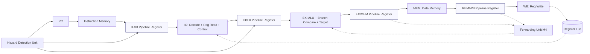

# LIMO — Architecture and Block Diagram

**Silicon Minds · CS3520 · NUL · AY2026/2027**  
**Milestone 2 — Simulator Design**

---

## 1) Overview

LIMO is a 32-bit, load–store, in-order processor derived from RISC-V RV32I, with a Sesotho assembly language. It implements a classic **five-stage pipeline** (IF, ID, EX, MEM, WB) with pipeline registers between stages. Only `kenya` (load word) and `boloka` (store word) access data memory. The machine is byte-addressed, little-endian, and word-aligned.

---

## 2) Register File

LIMO uses a **16-register** general-purpose register file (chosen for smaller field widths and efficient forwarding comparators).

| Register | Sesotho Name | Architectural Role |
|-----------|---------------|--------------------|
| x0 | lefela | Hard-wired zero |
| x1 | mohlophisi | Assembler/reserved |
| x2 | mokgethi | Stack pointer |
| x3 | motjha | General purpose |
| x4 | motjha-pele | General purpose |
| x5 | ntho | General purpose |
| x6 | ntho-pele | General purpose |
| x7 | ntho-tharo | General purpose |
| x8 | polokelo | General purpose |
| x9 | polokelo-pele | General purpose |
| x10 | phetiso | General purpose / return/value |
| x11 | phetiso-pele | General purpose / argument/value |
| x12 | phetiso-tharo | General purpose |
| x13 | phetiso-ne | General purpose |
| x14 | sebaka | General purpose |
| x15 | sebaka-pele | General purpose (return address/common use) |

**Program Counter (PC)** is a programmer-visible architectural register. 

**Microarchitectural registers** (not part of the ISA): IF/ID, ID/EX, EX/MEM, MEM/WB pipeline registers, IR/temporary latches — these exist only to support pipelining and must not be exposed to the programmer.

---

## 3) Pipeline Stages

| Stage | Name | Function |
|-------|------|----------|
| **IF** | Instruction Fetch | Fetch 32-bit instruction from Instruction Memory at PC. Compute PC+4. |
| **ID** | Instruction Decode | Decode instruction, read operands from register file, generate control signals, sign-extend immediate. Perform hazard detection in M3/M4. |
| **EX** | Execute | ALU operation, branch comparison, compute branch target (PC + immediate). Branches are **resolved in EX** (see §4). |
| **MEM** | Memory Access | Read or write Data Memory for `kenya`/`boloka`. Pass ALU result/address and data forward. |
| **WB** | Write Back | Write result to register file (ALU result or loaded data). Writes occur to complete instruction retirement. |

---

## 4) Branch Resolution & Pipeline Control

- **Branch resolution:** LIMO resolves branches in the **EX** stage. The branch condition is evaluated and the target `PC + immediate` is computed in EX.
- **Cost:** On a taken branch, the instructions fetched in **IF** and in **ID** are **younger** and must be **flushed** (converted to bubbles). The simulator counts **2 flushes** in the standard case.
- **Self-branch handling:** A self-branch (e.g. `fin: hlahloba lefela, lefela, fin`) is detected and the pipeline is drained and halted cleanly.
- **Conservative stalls (M3):** In the current baseline, RAW hazards stall in ID until the producer reaches **WB**. **Forwarding** (EX/MEM→EX, MEM/WB→EX) is planned for M4 with a Forwarding ON/OFF switch.

---

## 5) Block Diagram

*Note:* In M3 (current implementation), Hazard Detection performs stalls; Forwarding Unit is planned for M4.

---

## 6) Memories

| Memory | Type | Notes |
|--------|------|-------|
| **Instruction Memory (IMEM)** | Read-only in simulation | Loaded from assembled LIMO program; word-aligned accesses. |
| **Data Memory (DMEM)** | Read/Write | Accessed only by `kenya` (load) and `boloka` (store). Byte-addressed, word-aligned in normal use. |

---

## 7) Control Signals (ID-generated)

Key control signals generated in ID and carried down the pipeline: `RegWrite`, `ALUSrc`, `ALUControl`, `MemRead`, `MemWrite`, `MemToReg`, `Branch`, `PCSrc` (and branch type). These are displayed in the **Control Signals** panel of the simulator.

---

## 8) Design Decisions (Summary)

- **16 registers** reduce encoding bits and forwarding comparator width while keeping register pressure reasonable.
- **Branches in EX** trades extra flushes for simpler hardware compared to resolving earlier/later.
- **Load-use** cannot always be fully resolved by forwarding alone and requires a stall in this design.
- **RISC-V-like formats (R/I/S/B)** keep encoding regular and easy to decode.

---

**References:** Patterson & Hennessy (RISC-V Edition), Harris & Harris (DDCA RISC-V Edition), course ISA specification (`docs/ISA-specification.md`).
